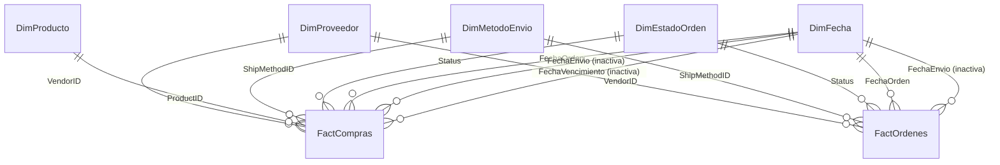

# Criterio 3 — Modelo en estrella para Power BI

**Proyecto:** BI Purchasing — AdventureWorks2  
**Responsable de la parte de datos:** Molina  
**Entregable:** `Compras_v1_Molina.pbix` + documentación del modelo y de las medidas DAX  
**Fecha de referencia:** sprint del 4 al 10 de noviembre de 2026

---

## 1. Objetivo y alcance

Dejar un modelo dimensional limpio y validado en Power BI Desktop para que Sebastián construya los dashboards (v2) sin tener que volver a los CSV ni resolver relaciones.

El alcance de esta entrega es:

- Conectar Power BI Desktop a la base **AdventureWorks2**.
- Armar un modelo en estrella con dimensiones y hechos.
- Excluir los proveedores de prueba **1699** y **1700**.
- Dejar las medidas DAX básicas y avanzadas documentadas.
- Guardar el archivo como `Compras_v1_Molina.pbix`.
- Entregar el `.pbix` y esta documentación a Sebastián.

La construcción de las páginas visuales del dashboard queda a cargo de Sebastián (v2). En esta entrega solo se incluye una página de validación sugerida.

---

## 2. Entregables

| Archivo | Qué contiene |
|---|---|
| `sql/01_modelo_estrella.sql` | Crea el esquema `bi` y las vistas del modelo en AdventureWorks2. Ya fue ejecutado y validado. |
| `powerbi/medidas_basicas.dax` | 24 medidas básicas para tarjetas KPI. |
| `powerbi/medidas_avanzadas.dax` | 38 medidas avanzadas de tiempo, ranking, concentración, calidad y ventanas móviles. |
| `docs/criterio3_modelo_estrella.md` | Este documento: diseño, relaciones, exclusión y validación. |
| `docs/criterio3_medidas_dax.md` | Catálogo de medidas con explicación y formato. |
| `docs/criterio3_guia_powerbi.md` | Paso a paso para construir el `.pbix` en Power BI Desktop. |
| `src/load_vendor_segments.py` | Carga opcional de los segmentos K-Means en `bi.VendorSegmento`. |

---

## 3. Fuente de datos y conexión

| Parámetro | Valor |
|---|---|
| Motor | Azure SQL Database |
| Servidor | `sebastian-sql-server-2026.database.windows.net` |
| Base de datos | `AdventureWorks2` |
| Autenticación | SQL Server (usuario y contraseña) |
| Esquema del modelo | `bi` |
| Esquema de origen | `Purchasing`, `Production`, `Person` |

> **Seguridad:** las credenciales no se guardan en el repositorio. Se ingresan directamente en Power BI Desktop al crear la conexión. No subir el archivo `.pbix` con credenciales embebidas a GitHub.

Las vistas del esquema `bi` ya están creadas en la base. Si hay que recrearlas, ejecutar `sql/01_modelo_estrella.sql` conectado a `AdventureWorks2`.

---

## 4. Arquitectura del modelo

### 4.1 Diagrama



Vista simplificada:

```text
                         ┌──────────────────┐
                         │   DimProveedor   │
                         │  (104 filas)     │
                         └────────┬─────────┘
                                  │ 1:*
        ┌──────────────────┐      │      ┌──────────────────┐
        │   DimProducto    │      │      │  DimMetodoEnvio  │
        │   (504 filas)    │      │      │    (5 filas)     │
        └────────┬─────────┘      │      └────────┬─────────┘
                 │ 1:*            │               │ 1:*
                 │        ┌───────┴───────┐       │
                 └───────▶│  FactCompras  │◀──────┘
                          │  (8.846 filas)│
                          │  grano: línea │
                          └───────┬───────┘
                                  │
        ┌──────────────────┐      │      ┌──────────────────┐
        │   DimEstadoOrden │──────┤      │     DimFecha     │
        │    (4 filas)     │      │      │   (2.191 filas)  │
        └──────────────────┘      │      └────────┬─────────┘
                                  │               │
                          ┌───────┴───────┐       │
                          │  FactOrdenes  │◀──────┘
                          │  (4.015 filas)│
                          │  grano: orden │
                          └───────────────┘
```

### 4.2 Dimensiones

| Tabla | Grano | Filas | Clave | Descripción |
|---|---|---:|---|---|
| `bi.DimProveedor` | 1 fila por proveedor real | 104 | `VendorID` | Maestro de proveedores, dirección principal, calificación, estado y segmento K-Means (si está cargado). |
| `bi.DimProducto` | 1 fila por producto | 504 | `ProductID` | Producto, subcategoría y categoría. |
| `bi.DimFecha` | 1 fila por día | 2.191 | `Date` | Calendario 2022-01-01 a 2027-12-31. |
| `bi.DimMetodoEnvio` | 1 fila por método | 5 | `ShipMethodID` | Catálogo de métodos de envío. |
| `bi.DimEstadoOrden` | 1 fila por estado | 4 | `Status` | Traducción de `Status`: Pendiente, Aprobada, Rechazada, Completada. |

### 4.3 Tablas de hechos

| Tabla | Grano | Filas | Descripción |
|---|---|---:|---|
| `bi.FactCompras` | 1 fila por línea de orden | 8.846 | Cantidades, precio unitario, `LineTotal`, recibido, rechazado y fechas de la línea. |
| `bi.FactOrdenes` | 1 fila por orden | 4.015 | `SubTotal`, `TaxAmt`, `Freight`, `TotalDue`, estado y fechas de la cabecera. |

**¿Por qué dos tablas de hechos?** Porque `TotalDue`, `SubTotal`, `TaxAmt` y `Freight` están en la cabecera. Si se copian en cada línea de `FactCompras`, al sumarlos se duplican. Separando los hechos:

- `FactCompras` responde preguntas por producto, línea, cantidad y rechazo.
- `FactOrdenes` responde preguntas por orden, estado, `TotalDue` y valor promedio por orden.
- Ambas comparten las mismas dimensiones, así que los filtros de proveedor, fecha, método de envío y estado funcionan en las dos.

> **Regla de oro:** no sumar `[Total Comprado]` y `[Total con Impuestos y Flete]` en la misma tarjeta. Son dos métricas distintas: la primera es valor de líneas; la segunda es `TotalDue` de cabecera (incluye impuestos y flete).

### 4.4 Relaciones

Crear en la vista **Modelo** de Power BI Desktop:

| Desde (1) | Hacia (*) | Cardinalidad | Dirección | Activa |
|---|---|---|---|---|
| `DimProveedor[VendorID]` | `FactCompras[VendorID]` | 1:* | Simple | Sí |
| `DimProveedor[VendorID]` | `FactOrdenes[VendorID]` | 1:* | Simple | Sí |
| `DimProducto[ProductID]` | `FactCompras[ProductID]` | 1:* | Simple | Sí |
| `DimMetodoEnvio[ShipMethodID]` | `FactCompras[ShipMethodID]` | 1:* | Simple | Sí |
| `DimMetodoEnvio[ShipMethodID]` | `FactOrdenes[ShipMethodID]` | 1:* | Simple | Sí |
| `DimEstadoOrden[Status]` | `FactCompras[Status]` | 1:* | Simple | Sí |
| `DimEstadoOrden[Status]` | `FactOrdenes[Status]` | 1:* | Simple | Sí |
| `DimFecha[Date]` | `FactCompras[FechaOrden]` | 1:* | Simple | Sí |
| `DimFecha[Date]` | `FactOrdenes[FechaOrden]` | 1:* | Simple | Sí |
| `DimFecha[Date]` | `FactCompras[FechaEnvio]` | 1:* | Simple | **No** |
| `DimFecha[Date]` | `FactCompras[FechaVencimiento]` | 1:* | Simple | **No** |
| `DimFecha[Date]` | `FactOrdenes[FechaEnvio]` | 1:* | Simple | **No** |

Las relaciones inactivas se usan con `USERELATIONSHIP` en las medidas de fecha de envío y fecha de vencimiento.

---

## 5. Exclusión de los proveedores de prueba 1699 y 1700

La exclusión está aplicada en las vistas `bi.DimProveedor`, `bi.FactCompras` y `bi.FactOrdenes` con:

```sql
WHERE VendorID NOT IN (1699, 1700)
```

### 5.1 Evidencia de que son registros de prueba

| VendorID | Nombre | Órdenes | TotalDue | Tipo de dirección |
|---:|---|---:|---:|---|
| 1699 | Distribuidora Ejemplo S.A. | 3 (7015, 7016, 7017) | 83,10 | Home |
| 1700 | garfield | 1 (7018) | 17,00 | Home |
| Resto de proveedores | — | 4.015 | 70.486.331,59 | Main Office (104 de 104) |

Las cuatro órdenes de prueba están en estado **Pendiente** y tienen fechas de septiembre de 2026. Los 104 proveedores reales tienen dirección **Main Office**; los dos de prueba tienen **Home**. Esa diferencia también sirve como control de calidad.

### 5.2 Efecto de la exclusión

| Métrica | Con 1699/1700 | Sin 1699/1700 | Diferencia |
|---|---:|---:|---:|
| Proveedores | 106 | 104 | 2 |
| Órdenes | 4.019 | 4.015 | 4 |
| Líneas | 8.853 | 8.846 | 7 |
| Total líneas | 63.792.134,94 | 63.792.094,84 | 40,10 |
| TotalDue (grano orden) | 70.486.431,69 | 70.486.331,59 | 100,10 |

> Las cuatro órdenes de prueba suman `100,10` de `TotalDue` y `40,10` de líneas. Lo importante es que **ninguna fila de 1699/1700 entra al modelo**. El `TotalDue` de la tabla se calcula a nivel de orden; si se sumara después de unir cabecera con detalle, se duplicaría una vez por línea.

### 5.3 Validación rápida

```sql
SELECT COUNT(*) AS PruebaEnFactCompras
FROM bi.FactCompras
WHERE VendorID IN (1699, 1700);   -- debe dar 0

SELECT COUNT(*) AS PruebaEnFactOrdenes
FROM bi.FactOrdenes
WHERE VendorID IN (1699, 1700);   -- debe dar 0
```

---

## 6. Calidad de datos y anomalías documentadas

Estas observaciones vienen del EDA y se confirmaron contra la base:

1. **18 proveedores sin órdenes.** Quedan en `DimProveedor` (104 proveedores), pero no aparecen en `FactCompras` ni en `FactOrdenes`. En los visuales se pueden mostrar como "Sin compras".
2. **Órdenes sin detalle.**
   - `6013` (proveedor 1492, 2026-08-20): `SubTotal = 0`, `TotalDue = 0`, sin líneas.
   - `7013` (proveedor 1492, 2026-08-25): `SubTotal = 0`, `TotalDue = 300`, sin líneas.
   - Por eso `[Número de Órdenes]` (4.015) es mayor que `[Número de Órdenes con Detalle]` (4.013). La medida `[Órdenes sin Detalle]` deja esta diferencia visible.
3. **Orden 9 con `SubTotal` inconsistente.** La cabecera tiene `SubTotal = 6.966,00`, pero la suma de sus 5 líneas es `694,17` (diferencia de `6.271,83`). El modelo no corrige el origen: `FactCompras` usa las líneas y `FactOrdenes` usa la cabecera. La medida `[Diferencia TotalDue vs Líneas]` permite monitorear esta y otras diferencias.
4. **Estados de las órdenes (sin 1699/1700).**

   | Estado | Órdenes | TotalDue |
   |---|---:|---:|
   | Completada | 3.688 | 62.785.395,45 |
   | Pendiente | 229 | 3.881.645,68 |
   | Aprobada | 12 | 2.380.772,81 |
   | Rechazada | 86 | 1.438.517,64 |

5. **Productos sin subcategoría.** 209 productos del maestro no tienen subcategoría. `DimProducto` los muestra como `Sin categoría` / `Sin subcategoría`.
6. **Fechas.** En la base son `datetime`; en las vistas se convierten a `date` para que las relaciones con `DimFecha` sean limpias.
7. **Segmentos K-Means.** La segmentación final tiene 88 proveedores con segmento (40 Grandes recurrentes, 39 Pequeños recurrentes, 9 Ocasionales) y 18 proveedores sin órdenes que no recibieron segmento en el modelo original. Si se carga `bi.VendorSegmento`, `DimProveedor[Segmento]` muestra el segmento; si no, muestra `Sin segmento`. Los proveedores 1699 y 1700 no se cargan.

---

## 7. Construcción en Power BI Desktop

El paso a paso detallado está en `docs/criterio3_guia_powerbi.md`. Resumen:

1. **Abrir Power BI Desktop.**
2. **Obtener datos → Azure SQL Database.**
   - Servidor: `sebastian-sql-server-2026.database.windows.net`
   - Base de datos: `AdventureWorks2`
   - Autenticación: usuario y contraseña de SQL.
3. **Seleccionar las vistas del esquema `bi`:**
   - `bi.DimProveedor`
   - `bi.DimProducto`
   - `bi.DimFecha`
   - `bi.DimMetodoEnvio`
   - `bi.DimEstadoOrden`
   - `bi.FactCompras`
   - `bi.FactOrdenes`
4. **Cargar** (no hace falta transformar: las vistas ya vienen limpias).
5. **Crear las relaciones** de la sección 4.4.
6. **Marcar `DimFecha` como tabla de fechas** usando la columna `Date`.
7. **Ocultar las claves** en las tablas de hechos y dimensiones (`VendorID`, `ProductID`, `ShipMethodID`, `Status`, `PurchaseOrderID`, etc.).
8. **Ajustar formatos** (moneda, porcentaje, fecha) y ordenar `Mes`, `AñoMes`, `DíaSemana` y `Trimestre` por sus columnas numéricas.
9. **Crear la tabla `_Medidas`** y agregar las medidas de `powerbi/medidas_basicas.dax` y `powerbi/medidas_avanzadas.dax`.
10. **Guardar como** `Compras_v1_Molina.pbix`.

---

## 8. Validación del modelo

Después de cargar las vistas y crear las medidas, comparar contra estos valores:

| Verificación | Medida / consulta | Resultado esperado |
|---|---|---|
| Proveedores en la dimensión | `COUNTROWS(DimProveedor)` | **104** |
| Proveedores con compras | `[Proveedores con Compras]` | **86** |
| Órdenes totales | `[Número de Órdenes]` | **4.015** |
| Órdenes con detalle | `[Número de Órdenes con Detalle]` | **4.013** |
| Líneas de compra | `COUNTROWS(FactCompras)` | **8.846** |
| Total comprado (líneas) | `[Total Comprado]` | **63.792.094,84** |
| Total con impuestos y flete | `[Total con Impuestos y Flete]` | **70.486.331,59** |
| Unidades compradas | `[Unidades Compradas]` | **2.348.638** |
| Unidades recibidas | `[Cantidad Recibida]` | **2.327.299** |
| Unidades rechazadas | `[Cantidad Rechazada]` | **72.700** |
| Productos comprados | `[Productos Comprados]` | **266** |
| Órdenes completadas | `[Órdenes Completadas]` | **3.688** |
| Órdenes pendientes | `[Órdenes Pendientes]` | **229** |
| Órdenes aprobadas | `CALCULATE([Número de Órdenes], DimEstadoOrden[Estado]="Aprobada")` | **12** |
| Órdenes rechazadas | `[Órdenes Rechazadas]` | **86** |
| Proveedores 1699/1700 en hechos | `COUNTROWS(FILTER(FactCompras, [VendorID] IN {1699,1700}))` | **0** |
| Fechas en DimFecha | `COUNTROWS(DimFecha)` | **2.191** |

También se puede validar directamente en SQL con:

```sql
SELECT 'DimProveedor' AS Objeto, COUNT(*) AS Filas FROM bi.DimProveedor
UNION ALL SELECT 'DimProducto', COUNT(*) FROM bi.DimProducto
UNION ALL SELECT 'DimFecha', COUNT(*) FROM bi.DimFecha
UNION ALL SELECT 'DimMetodoEnvio', COUNT(*) FROM bi.DimMetodoEnvio
UNION ALL SELECT 'DimEstadoOrden', COUNT(*) FROM bi.DimEstadoOrden
UNION ALL SELECT 'FactCompras', COUNT(*) FROM bi.FactCompras
UNION ALL SELECT 'FactOrdenes', COUNT(*) FROM bi.FactOrdenes;
```

---

## 9. Segmentos de proveedores (opcional)

El modelo funciona sin los segmentos. Si se quieren usar en los dashboards:

1. Ejecutar los notebooks de Molina para generar `data/processed/purchasing_segmentacion_final.csv` y, si está disponible, `data/processed/prediccion_18_proveedores.csv`.
2. Ejecutar:

   ```bash
   python src/load_vendor_segments.py
   ```

3. En Power BI, actualizar `bi.DimProveedor`. La columna `Segmento` mostrará:
   - `Grandes recurrentes`
   - `Pequeños recurrentes`
   - `Ocasionales`
   - `Sin segmento` para los 18 proveedores sin órdenes.
   - `SegmentoEsEstimado = 1` para los segmentos predichos por el modelo de la HU 6.

> La segmentación es descriptiva y no una clasificación formal de tamaño empresarial. Ver las limitaciones en el notebook `04_segmentacion_kmeans_HU3_2.ipynb` y en el README.

---

## 10. Handoff a Sebastián

Entregar:

- `Compras_v1_Molina.pbix` con el modelo cargado y las medidas.
- `docs/criterio3_modelo_estrella.md` (este documento).
- `docs/criterio3_medidas_dax.md`.
- `docs/criterio3_guia_powerbi.md`.
- `powerbi/medidas_basicas.dax` y `powerbi/medidas_avanzadas.dax`.

Mensaje sugerido:

> Sebastián: te paso `Compras_v1_Molina.pbix` con el modelo en estrella ya armado y validado. Incluye las dimensiones de proveedor, producto, fecha, método de envío y estado, más dos hechos: `FactCompras` (grano línea) y `FactOrdenes` (grano orden). Los proveedores 1699 y 1700 están excluidos en las vistas. Las medidas básicas están en `powerbi/medidas_basicas.dax` y las avanzadas en `powerbi/medidas_avanzadas.dax`. La documentación del modelo y la validación está en `docs/criterio3_modelo_estrella.md`. Para las tarjetas KPI usa las medidas de la carpeta `01 Básicas`; para los análisis de tiempo y concentración, las de `02 Avanzadas`.

---

## 11. Checklist de la rúbrica (parte de datos)

- [x] Conexión a AdventureWorks2 definida y probada.
- [x] Modelo en estrella con dimensiones y hechos.
- [x] Exclusión de los proveedores de prueba 1699 y 1700.
- [x] Vistas SQL creadas y verificadas (104 proveedores, 4.015 órdenes, 8.846 líneas).
- [x] Medidas DAX básicas documentadas.
- [x] Medidas DAX avanzadas documentadas.
- [x] Diagrama del modelo y relaciones documentados.
- [ ] Guardar `Compras_v1_Molina.pbix` (paso manual en Power BI Desktop).
- [ ] Enviar el `.pbix` a Sebastián.

Los dos últimos pasos se completan siguiendo `docs/criterio3_guia_powerbi.md`.
